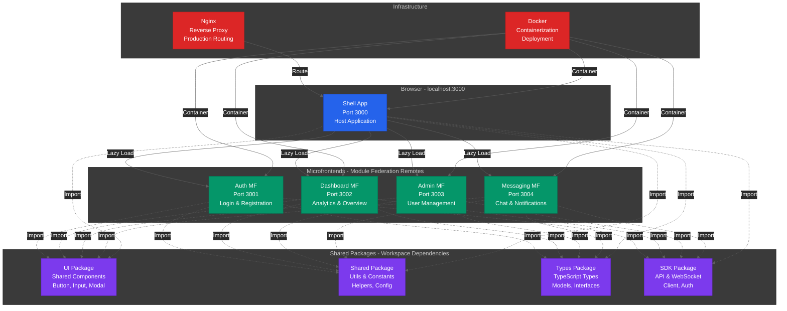

# Module Federation App Template

A production-ready monorepo template using Module Federation with React, Vite, TypeScript, and Turbo. This template provides a complete microfrontend architecture with shared packages, type safety, and modern development tools.

**Created by:** [enzox0](https://github.com/enzox0)

## Table of Contents

- [What is This Template?](#what-is-this-template)
- [Project Structure](#project-structure)
- [Getting Started](#getting-started)
- [Development Workflow](#development-workflow)
- [Working with Microfrontends](#working-with-microfrontends)
- [Working with Shared Packages](#working-with-shared-packages)
- [Building and Deployment](#building-and-deployment)
- [Troubleshooting](#troubleshooting)

## Architecture Overview



## What is This Template?

This template provides a complete microfrontend architecture using Module Federation, allowing you to:

- **Build independent microfrontends** that can be developed, tested, and deployed separately
- **Share code efficiently** through workspace packages (UI components, utilities, types)
- **Scale your team** by allowing different teams to own different microfrontends
- **Deploy independently** without rebuilding the entire application

### Key Technologies

- **Module Federation**: Runtime code sharing between applications
- **React 18**: Modern React with concurrent features
- **TypeScript**: Full type safety across all packages
- **Vite**: Lightning-fast dev server and optimized builds
- **Turbo**: Intelligent monorepo task orchestration with caching
- **pnpm workspaces**: Efficient dependency management
- **Tailwind CSS**: Utility-first CSS framework (configured and ready)

## Project Structure

```
module-federation-app/
├── apps/
│   ├── shell/              # Host application (port 3000)
│   │                       # - Loads and orchestrates all microfrontends
│   │                       # - Handles routing and navigation
│   │                       # - Provides shared layout and error boundaries
│   │
│   ├── auth-mf/            # Auth microfrontend (port 3001)
│   │                       # - Login, registration, password reset
│   │                       # - User authentication flows
│   │
│   ├── dashboard-mf/       # Dashboard microfrontend (port 3002)
│   │                       # - Main dashboard views
│   │                       # - Analytics and overview
│   │
│   ├── admin-mf/           # Admin microfrontend (port 3003)
│   │                       # - User management
│   │                       # - Roles and permissions
│   │                       # - System settings
│   │
│   └── messaging-mf/       # Messaging microfrontend (port 3004)
│                           # - Real-time chat
│                           # - Notifications
│
├── packages/
│   ├── ui/                 # Shared UI components
│   │                       # - Button, Input, Modal, etc.
│   │                       # - Consistent design system
│   │
│   ├── shared/             # Shared utilities and constants
│   │                       # - Helper functions
│   │                       # - Common constants
│   │                       # - Configuration utilities
│   │
│   ├── types/              # Shared TypeScript types
│   │                       # - API response types
│   │                       # - Domain models
│   │                       # - Shared interfaces
│   │
│   └── sdk/                # SDK for API and WebSocket
│                           # - API client
│                           # - WebSocket manager
│                           # - Authentication helpers
│
└── infrastructure/
    ├── nginx/              # Nginx configuration for production
    └── docker/             # Docker configurations for deployment
```

## Getting Started

### Step 1: Prerequisites

Before you begin, ensure you have the following installed:

1. **Node.js 20 or higher**
   ```bash
   node --version  # Should be v20.x.x or higher
   ```
   Download from: https://nodejs.org/

2. **pnpm 9 or higher**
   ```bash
   pnpm --version  # Should be 9.x.x or higher
   ```
   Install pnpm:
   ```bash
   npm install -g pnpm
   ```

### Step 2: Clone or Use This Template

If you're using this as a GitHub template:
```bash
# Click "Use this template" on GitHub, then clone your new repo
git clone https://github.com/your-username/your-project-name.git
cd your-project-name
```

Or if you have the template locally:
```bash
cd path/to/template
```

### Step 3: Install Dependencies

Install all dependencies for the entire monorepo:

```bash
pnpm install
```

This will:
- Install dependencies for all apps and packages
- Set up workspace links between packages
- Prepare the monorepo for development

**Expected output:** You should see pnpm installing packages and linking workspaces. This may take 1-3 minutes on first install.

### Step 4: Verify Installation

Check that everything is set up correctly:

```bash
# Check workspace structure
pnpm list --depth 0

# Verify TypeScript configuration
pnpm turbo run lint --dry-run
```

## Development Workflow

### Starting the Development Environment

**Important:** Module Federation requires all remote microfrontends to be running before the shell (host) app can load them.

#### Option 1: Start All Apps at Once (Recommended)

From the root directory:

```bash
pnpm dev
```

This command:
- Starts all 5 applications simultaneously
- Uses Turbo to parallelize the startup process
- Shows logs from all apps in a single terminal

**What to expect:**
- Initial startup takes 10-30 seconds as all apps build
- You'll see build output from all 5 apps
- Once you see "ready in X ms" for all apps, they're ready to use

#### Option 2: Start Apps Individually

If you prefer separate terminal windows for each app:

**Terminal 1 - Auth Microfrontend:**
```bash
cd apps/auth-mf
pnpm dev
```
Wait for: `ready in X ms` message

**Terminal 2 - Dashboard Microfrontend:**
```bash
cd apps/dashboard-mf
pnpm dev
```
Wait for: `ready in X ms` message

**Terminal 3 - Admin Microfrontend:**
```bash
cd apps/admin-mf
pnpm dev
```
Wait for: `ready in X ms` message

**Terminal 4 - Messaging Microfrontend:**
```bash
cd apps/messaging-mf
pnpm dev
```
Wait for: `ready in X ms` message

**Terminal 5 - Shell (Host) App:**
```bash
cd apps/shell
pnpm dev
```
Wait for: `ready in X ms` message

### Step 5: Access the Application

Once all apps are running:

1. Open your browser to **http://localhost:3000**
2. Check the **Remote Status indicator** in the bottom-right corner
   - Green dots = All remotes are healthy
   - Red dots = Some remotes are unavailable
3. Navigate through the app to verify all microfrontends load correctly

### Development Ports

| Application | Port | URL |
|------------|------|-----|
| Shell (Host) | 3000 | http://localhost:3000 |
| Auth MF | 3001 | http://localhost:3001 |
| Dashboard MF | 3002 | http://localhost:3002 |
| Admin MF | 3003 | http://localhost:3003 |
| Messaging MF | 3004 | http://localhost:3004 |

**Note:** You can access individual microfrontends directly at their ports for isolated development and testing.

## Working with Microfrontends

### Creating a New Microfrontend

1. **Copy an existing microfrontend as a template:**
   ```bash
   cp -r apps/auth-mf apps/my-new-mf
   cd apps/my-new-mf
   ```

2. **Update package.json:**
   ```json
   {
     "name": "@template/my-new-mf",
     "version": "0.0.0",
     "scripts": {
       "dev": "vite --port 3005",
       ...
     }
   }
   ```

3. **Update module-federation.config.ts:**
   ```typescript
   export default {
     name: 'myNewMf',
     filename: 'remoteEntry.js',
     exposes: {
       './App': './src/exposes.tsx',
     },
     shared: {
       react: { singleton: true },
       'react-dom': { singleton: true },
     },
   };
   ```

4. **Register in the shell app** (`apps/shell/src/App.tsx`):
   ```typescript
   const MyNewMfApp = lazy(() => import('myNewMf/App'));
   
   // Add route
   <Route path="/my-feature/*" element={<MyNewMfApp />} />
   ```

5. **Install dependencies and start:**
   ```bash
   pnpm install
   pnpm dev
   ```

### Modifying an Existing Microfrontend

1. **Navigate to the microfrontend:**
   ```bash
   cd apps/auth-mf  # or any other microfrontend
   ```

2. **Make your changes** in the `src/` directory

3. **Hot reload** will automatically update the browser

4. **Test in isolation** by visiting the microfrontend's direct URL (e.g., http://localhost:3001)

5. **Test in the shell** by visiting http://localhost:3000 and navigating to the route

### Exposing Components from a Microfrontend

To expose a component for use by other apps:

1. **Update module-federation.config.ts:**
   ```typescript
   exposes: {
     './App': './src/exposes.tsx',
     './MyComponent': './src/components/MyComponent.tsx',
   }
   ```

2. **Use in another app:**
   ```typescript
   const MyComponent = lazy(() => import('authMf/MyComponent'));
   ```

## Working with Shared Packages

### Using Shared Packages

All shared packages are automatically available in your apps:

```typescript
// Import from shared UI components
import { Button, Input, Modal } from '@template/ui';

// Import from shared utilities
import { formatDate, debounce } from '@template/shared';

// Import from shared types
import type { User, ApiResponse } from '@template/types';

// Import from SDK
import { apiClient, wsManager } from '@template/sdk';
```

### Modifying Shared Packages

1. **Navigate to the package:**
   ```bash
   cd packages/ui  # or shared, types, sdk
   ```

2. **Make your changes**

3. **Build the package** (if needed):
   ```bash
   pnpm build
   ```

4. **Changes are automatically reflected** in all apps using the package (thanks to workspace linking)

### Adding a New Shared Component

**Example: Adding a new Button variant to @template/ui**

1. **Create the component:**
   ```bash
   cd packages/ui/src/components
   # Create your component file
   ```

2. **Export it from the package:**
   ```typescript
   // packages/ui/src/index.ts
   export { Button } from './components/Button';
   export { NewComponent } from './components/NewComponent';
   ```

3. **Use it in any app:**
   ```typescript
   import { NewComponent } from '@template/ui';
   ```

### Adding a New Shared Package

1. **Create the package directory:**
   ```bash
   mkdir packages/my-package
   cd packages/my-package
   ```

2. **Initialize package.json:**
   ```json
   {
     "name": "@template/my-package",
     "version": "0.0.0",
     "main": "./src/index.ts",
     "types": "./src/index.ts",
     "exports": {
       ".": "./src/index.ts"
     }
   }
   ```

3. **Create your code:**
   ```bash
   mkdir src
   echo "export const myUtil = () => 'Hello';" > src/index.ts
   ```

4. **Add to apps that need it:**
   ```json
   // In any app's package.json
   {
     "dependencies": {
       "@template/my-package": "workspace:*"
     }
   }
   ```

5. **Install and use:**
   ```bash
   pnpm install
   ```

## Building and Deployment

### Building for Production

**Build all apps and packages:**
```bash
pnpm build
```

This command:
- Builds all shared packages first
- Then builds all applications
- Uses Turbo's caching to skip unchanged packages
- Outputs to `dist/` folders in each app

**Build a specific app:**
```bash
pnpm --filter @template/shell build
pnpm --filter @template/auth-mf build
```

### Linting and Type Checking

**Run linting across all packages:**
```bash
pnpm lint
```

**Run type checking:**
```bash
pnpm type-check
```

**Fix linting issues automatically:**
```bash
pnpm lint:fix
```

### Testing Your Build Locally

After building, you can test the production build:

```bash
# Build first
pnpm build

# Serve the shell app
cd apps/shell
pnpm preview

# In separate terminals, serve each microfrontend
cd apps/auth-mf && pnpm preview
cd apps/dashboard-mf && pnpm preview
cd apps/admin-mf && pnpm preview
cd apps/messaging-mf && pnpm preview
```

### Deployment Strategies

#### Strategy 1: Deploy All Together

Deploy all apps to the same infrastructure:
- Build all apps
- Deploy to a single server or CDN
- Use Nginx to route requests (see `infrastructure/nginx/`)

#### Strategy 2: Independent Deployment

Deploy each microfrontend independently:
- Build and deploy each app to its own URL
- Update the shell app's remote URLs to point to production URLs
- Deploy the shell app last

**Example production configuration:**
```typescript
// apps/shell/module-federation.config.ts
remotes: {
  authMf: 'https://auth.yourapp.com/remoteEntry.js',
  dashboardMf: 'https://dashboard.yourapp.com/remoteEntry.js',
  adminMf: 'https://admin.yourapp.com/remoteEntry.js',
  messagingMf: 'https://messaging.yourapp.com/remoteEntry.js',
}
```

### Docker Deployment

Build and run with Docker:

```bash
# Build Docker images
docker-compose build

# Start all services
docker-compose up

# Access at http://localhost
```

## Troubleshooting

### Common Issues and Solutions

#### Issue: "Failed to fetch dynamically imported module"

**Cause:** A remote microfrontend is not running or not accessible.

**Solutions:**
1. Ensure all apps are running: `pnpm dev` from root
2. Check the Remote Status indicator (bottom-right corner)
3. Verify no port conflicts (ports 3000-3004 should be free)
4. Wait for all apps to complete their initial build
5. Try refreshing the browser or clearing cache
6. Check browser console for specific error messages

#### Issue: Port Already in Use

**Cause:** Another application is using one of the required ports.

**Solutions:**
```bash
# On Windows, find and kill the process
netstat -ano | findstr :3000
taskkill /PID <PID> /F

# Or change the port in package.json
"dev": "vite --port 3010"  # Use a different port
```

#### Issue: Changes Not Reflecting

**Cause:** Build cache or browser cache issues.

**Solutions:**
```bash
# Clear Turbo cache
pnpm turbo run build --force

# Clear Vite cache
rm -rf apps/*/node_modules/.vite

# Hard refresh browser
Ctrl + Shift + R (Windows/Linux)
Cmd + Shift + R (Mac)
```

#### Issue: TypeScript Errors

**Cause:** Type definitions out of sync or missing.

**Solutions:**
```bash
# Rebuild all packages
pnpm build

# Clear TypeScript cache
find . -name "*.tsbuildinfo" -delete

# Reinstall dependencies
rm -rf node_modules
pnpm install
```

#### Issue: Module Not Found

**Cause:** Workspace dependencies not linked properly.

**Solutions:**
```bash
# Reinstall and relink workspaces
pnpm install

# Verify workspace links
pnpm list --depth 0
```

### Getting Help

- Check the [detailed running guide](./.docs/RUNNING.md)
- Check the [quick start guide](./.docs/QUICK_START.md)
- Review Module Federation documentation: https://module-federation.io/
- Review Vite documentation: https://vitejs.dev/

## Features

- **Module Federation**: Runtime code sharing between microfrontends
- **React 18**: Modern React with concurrent features and Suspense
- **TypeScript**: Full type safety across all packages
- **Vite**: Lightning-fast HMR and optimized production builds
- **Turbo**: Intelligent build caching and task orchestration
- **pnpm Workspaces**: Efficient dependency management
- **Tailwind CSS**: Utility-first CSS framework (configured)
- **Error Boundaries**: Graceful error handling with retry functionality
- **Health Monitoring**: Real-time remote status indicators
- **Hot Module Replacement**: Instant updates during development
- **Production Ready**: Docker and Nginx configurations included

## Next Steps

1. **Customize the template** for your use case
2. **Add your business logic** to each microfrontend
3. **Create shared components** in the UI package
4. **Set up CI/CD** using the GitHub Actions workflows in `.github/workflows/`
5. **Configure environment variables** in `.env` files
6. **Add authentication** using the auth microfrontend
7. **Deploy to production** using your preferred hosting platform
